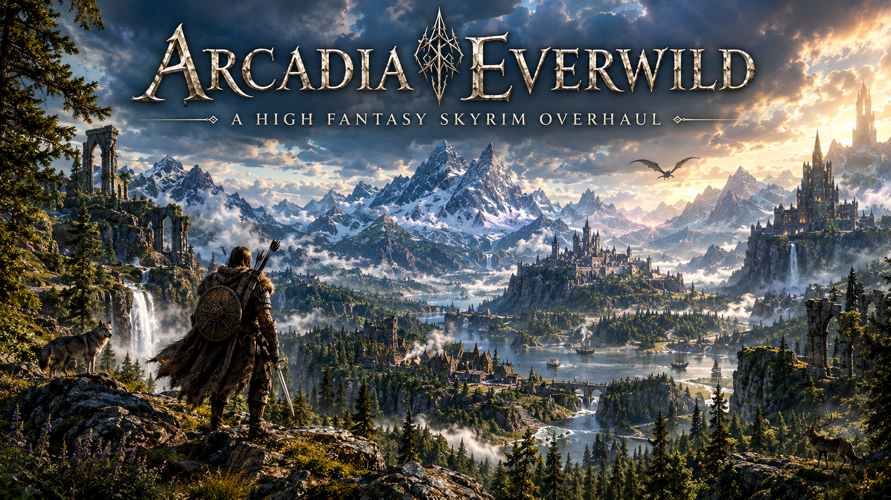

  

# Everwild Table of Contents

- [**How to Clean Install**](#CleanInstall)
- [**How to Configure PageFile**](#PageFile)
- [**How to Install**](#Installing)
- [**How to Set Up SkyrimNet (AI NPCs)**](#SkyrimNet)
- [**How to Keep your Save Stable**](#SafePlaying)
- [**what if i Crash?**](#Crashes)

##### The Player's Handbook for Everwild

https://github.com/CerberusX1/modlists/blob/main/EverwildGettingStarted.MD

## CleanInstall

Step 1: Uninstall via Steam

1. Open your Steam Library.
2. Right-click The Elder Scrolls V: Skyrim (or Special Edition), hover over Manage, and click Uninstall.

Step 2: Delete Residual Game and Mod Folders

Even after uninstalling through Steam, leftover files and mod configurations remain and can cause bugs. Manually delete the following directories:
• Steam Game Folder: Navigate to ..\\Steam\\steamapps\\common and delete the Skyrim or Skyrim Special Edition folder.
• Documents Folder: Navigate to C:\\Users\\[Your User Account]\\Documents\\My Games and delete the Skyrim or Skyrim Special Edition folder.
• Local AppData: Press Windows Key + R, type appdata, hit Enter, open the Local folder, and delete the Skyrim or Skyrim Special Edition folder.
• Mod Managers: Delete any leftover mod manager folders (such as Vortex or Mod Organizer 2) in your AppData directories if you are resetting your setup.

Step 3: Reinstall the Game

1. Go back to your Steam Library and click Install on Skyrim.
2. Avoid installing the game into the C:\\Program Files or C:\\Program Files (x86) directories to prevent Windows permission issues with mods.
3. Launch the game once from Steam to let it generate fresh configuration files, then download all owned creations, then close it

### PageFile

To improve system stability (specially if you have only 16 gb of RAM) you need to setup the page file system for the drive you are running Everwild on.

To do this hit Windows keyboard key and R key simultaneously, type sysdm.cpl and click OK

Select Advanced tab and under Performance click on Settings

Select Advanced tab and click on Change

Uncheck Automatically manage page file size for all drives

Select the drive where Everwild is installed and click on Custom size

Set the page file size from 20000 minimum to 40000 maximum and click on Set

Don't forget that the size you set will be taken as used space on your drive.

Click on OK (a reboot will be required)

#### Installing

Step 1 Launch Wabbajack

Step 2 Navigate to browse modlists, the select skyrim from the list of games.

step 3 locate Everwild and click on it, hit download.

step 4 set the location for the install, downloads should auto fill, hit install.

step 5 when finished downloading, launch mo2 from the specifiec folder and launch mo2 (optionaly right click send to desktop for shortcut)

step 6 make sure everwild is selected in the drop down and hit play.

## SkyrimNet

This section if for Skynet profile only and not required if your not on that profile.

SkyrimNet lets NPCs hold real conversations using AI. It needs a few pieces to work: an **LLM** (the brain, writes the dialogue), **TTS** (the voice) and **STT** (speech-to-text, only needed if you want to talk using your microphone). You can run each piece in the cloud (paid) or on your own PC (local), and mixing the two is totally fine.

You must pick **one** of the three options below. Everything is configured from the SkyrimNet dashboard.

### Step 1: First Launch

1. Launch Everwild through MO2 as normal.
2. SkyrimNet generates working default settings on first launch.
3. Open your browser and go to `localhost:8080` (or use the Open Dashboard entry in SkyrimNet's in-game wheel menu).
4. Follow the guided setup wizard, then pick one of the options below.

### Option A: Fateless (Recommended, easiest)

Fateless is SkyrimNet's own official service. One account covers everything SkyrimNet needs: dialogue, voices, speech recognition and bard songs. There are no API keys to manage, no other accounts to make and nothing to configure. The models are tuned for each job, so NPCs reply fast and stay in character. Because it all runs in the cloud, it barely affects your PC's performance.

1. Make sure SkyrimNet is **Beta29 or later** (you can check the version in your MO2 mod list).
2. Create an account at https://fateless.ai
3. On your account page, **pick a plan** (plans start at $10 a month) or **buy credit**.
4. Launch Everwild through MO2 as normal.
5. Open the SkyrimNet settings, choose **Fateless** as your provider and **sign in**.
6. Use the **Quick Setup** block on the dashboard Home page to test that dialogue and voice respond.
7. Load your save and talk to an NPC. That's it!

Tips:
- Fateless is optional. You can still use your own provider or run models locally.
- You can mix and match, for example Fateless for dialogue and a local engine for voices.
- Never share your Fateless login with anyone, including in Discord support posts.

### Option B: Other Paid / Cloud Providers

If you'd rather pick your own models, you can use your own API key. This is a bit more work than Fateless but gives you full control over which models you use and what you pay.

1. Go to https://openrouter.ai and make an account.
2. Add credits to your account (a few dollars lasts a long time) and create an **API key**.
3. In the SkyrimNet setup wizard (or in the dashboard under Providers → OpenRouter) paste in your key.
4. Pick a model. SkyrimNet ships with approved **presets** at several price points, so choose one of those if you're unsure. You can use a cheap, fast model for actions and a smarter model for dialogue.
5. Use the **Quick Setup** block on the dashboard Home page to test that your LLM responds.

Tips:
- Your key is stored once, so you don't have to re-enter it for each feature.
- The **Logs → API Requests** page shows what every request cost.
- Never share your API key with anyone, including in Discord support posts.
- NanoGPT, Nvidia NIM, Chutes or any custom OpenAI-compatible endpoint work the same way.

Cloud voice options (optional, paid): ElevenLabs and Inworld both support voice cloning.

### Option C: Local Hosting (free, but needs a strong PC)

Local hosting costs nothing per message, but the AI model has to share your graphics card with Skyrim. A heavily modded game already uses a lot of VRAM, so only do this if you have a high-end GPU (or a second PC on your network). Small local models give simpler conversations than Fateless or a cloud model.

**Local LLM**
1. Install a local model server such as **LM Studio** or **Ollama**.
2. Download a model and start the server. Small models such as **NVIDIA Nemotron 3.5 Bolt** are a good way to try SkyrimNet on an RTX GPU.
3. In the SkyrimNet dashboard, add a **custom provider** (OpenAI-compatible) and point it at your server:
   - LM Studio: `http://127.0.0.1:1234/v1`
   - Ollama: `http://localhost:11434/v1`
4. Enter the exact model name your server shows, and use any placeholder text for the API key if asked.
5. Test it with the Quick Setup block on the Home page.

If you have a second PC, run the server there and use that PC's LAN address instead of 127.0.0.1.

**Local Voice (TTS)**
- **Piper**: runs on your CPU inside the game, no GPU needed. Easiest choice, but no voice cloning.
- **PocketTTS**: runs locally with live voice cloning (GPU optional). Supports English, Spanish, French, German, Italian and Portuguese.
- **XTTS**: runs on a server you choose (your PC, your LAN, or a rented cloud GPU).

**Local Speech-to-Text (microphone)**
- SkyrimNet uses local **Whisper** by default and auto-downloads the model. It uses CUDA, Vulkan, OpenCL or CPU, whichever your PC supports.
- Smaller models are faster, bigger ones are more accurate. Cloud speech-to-text also works but is noticeably slower.

### Which one should I pick?

| | Fateless | Other cloud (OpenRouter etc.) | Local |
|---|---|---|---|
| Setup difficulty | Easiest (sign in) | Easy | Moderate |
| Cost | From $10/month | Small per-message cost | Free |
| PC requirements | Low | Low | RTX GPU recommended |
| Covers dialogue, voice and speech | Yes, one account | Dialogue (voice sold separately) | You set up each piece |

Not sure? Start with Fateless. If you later want more control, you can switch to your own provider or a local setup in the dashboard.

### SkyrimNet not working?
Join the discord and head to the support section. Please include your SkyrimNet log from the dashboard (and remove any API key or login details first).

#### Crashes

What do i do if i crash?

Step 1. try to reproduce the crash. if you can reproduce the crash continue to step 2, if not and it keeps crashing alot randomly then proceed to step 3

Step 2. if you can reproduce the crash, make a list of things that you did to cause it so that i can reproduce it.

Step 3. find your crash log, (it should automatically open it for you) 
\Documents\My Games\Skyrim Special Edition\SKSE
the file will look list this
crash-2026-10-12-200-17-1.log
there will be number variation, these are the dates and log numbers.

Step 4. join the discord and navigate to the support section and submit your finding.

Step 5. wait for help, i may be at work or sleeping this might take time, sometimes other members might also offer help.

##### SafePlaying

🔀 Avoid Alt+Tabbing
🚫 Avoid loading saves mid-session
📂 Practice safe saving (disable autosaves, save only during calm moments)
⚡ Quit other resource-hungry apps before launching your modlist
🖼️ Keep your graphics driver reasonably current, but test each update—if a new driver causes issues, roll back to the last stable version that worked well for you.
🔥 Return any overclocked hardware (usually excluding RAM using XMP or AMD EXPO) to stock speeds
👉 💾 Set your Windows Pagefile to 40,000 min and max (especially for 16GB of RAM or less).
😐 Averaging less than one crash in 4 hours usually isn't a major concern for any heavily modded Skyrim
